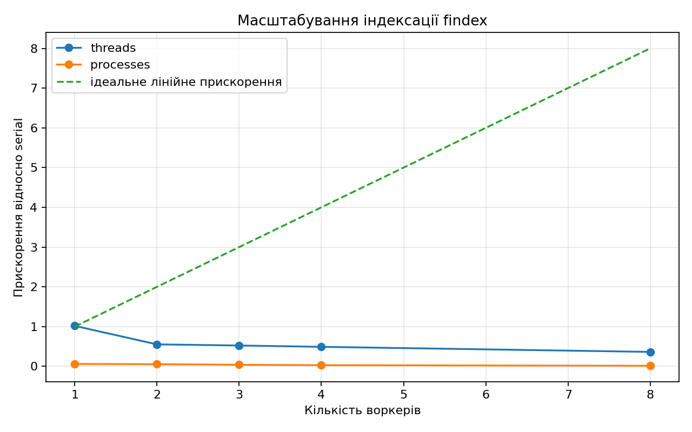

# findex — лабораторні роботи №1–5

Навчальна пошукова система: читання корпусу, інвертований індекс, Boolean-запити, TF-IDF/BM25, CLI.

[](https://github.com/9324749-cmd/findex/actions/workflows/ci.yml)

## Встановлення

Потрібен Python 3.11+ та [uv](https://docs.astral.sh/uv/).

```bash
uv sync --all-groups
uv run findex --help
```

Встановлення як окремого інструмента з каталогу репозиторію:

```bash
uv tool install .
findex --help
```

## Команди

```bash
findex index data --out index.bin
findex search "python AND async" --index index.bin --scorer bm25 --engine merge
findex search "python OR async" --index index.bin --json > results.json
findex stats --index index.bin
```

`-v` показує інформаційні повідомлення, `-vv` — докладніші діагностичні повідомлення. Діагностика спрямовується в stderr; JSON-результат команди `search --json` — у stdout.

## Тестування та якість

```bash
uv run pytest --cov=findex --cov-report=term-missing
uv run ruff check src tests
uv run pyright
```

Набір містить 69 тестових випадків після розгортання параметризації (pytest collection), зокрема шість тестів лабораторної 5: токенізатор і Unicode, парсер та AST, побудова індексу, merge/set, обидва скорери, серіалізація, CLI та три Hypothesis-властивості (round-trip, впорядкування posting-ів і Boolean merge).

**Покриття:** точний відсоток потрібно отримати локальним запуском команди вище; він навмисно не підставлений наперед, щоб не видавати неперевірене число за результат. Поза покриттям залишаються інтеграція з великими зовнішніми корпусами, продуктивність на промислових обсягах і поведінка на пошкоджених/недовірених pickle-файлах.

## Дані та безпека

Каталог `data/` містить навчальний корпус. Не відкривайте pickle-файли з невідомих джерел: формат pickle може виконувати код під час завантаження.

## Реліз

Для лабораторної 5 після локального проходження перевірок створіть тег `lab-05` та реліз `v0.5.0`. Wheel можна зібрати так:

```bash
uv build
```

Файл `dist/*.whl` потрібно прикріпити до GitHub Release вручну або через інструмент релізів GitHub.

# Лабораторна робота №5 — конкурентність і GIL

## Паралельна побудова індексу

`build_index()` розділено на три етапи: визначення списку шляхів, незалежна побудова часткових індексів через функцію рівня модуля `build_partial()` і об'єднання результатів функцією `merge()`. До воркерів передаються шляхи до файлів і шлях до кореня корпусу, а не завантажені тексти. Ідентифікатор документа — його відносний шлях у корпусі; він стабільний і унікальний для кожного файлу. `merge()` відхиляє повторні `doc_id`, а не перезаписує документи.

Приклади:

```bash
# Послідовно
findex index data --out index.bin --executor serial --workers 1

# Потоки
findex index data --out index-threads.bin --executor threads --workers 4

# Процеси
findex index data --out index-processes.bin --executor processes --workers 4

# Вимірювання: щонайменше три повтори кожної комбінації
uv run python scripts/benchmark_concurrency.py data --repeats 3
```

Типовий executor залишено `serial`, доки benchmark не покаже перевагу процесів саме на машині запуску. Якщо медіанний wall time для `processes` кращий, змініть типовий параметр `executor` у `src/findex/cli.py` на `processes`.

`ProcessPoolExecutor` використовує функцію-воркер на рівні модуля та передає їй лише серіалізовні рядки шляхів, тому схема сумісна з методом запуску процесів `spawn`. Виняток воркера отримується через `Future.result()` і не приховується: побудова індексу завершується помилкою замість повернення неповного індексу.

## Методика та результати вимірювань

Скрипт запускає послідовний варіант, а також потоки й процеси з 1, 2, 4, 8 та `os.cpu_count()` воркерами (повторні значення усуваються). Для кожної клітинки за замовчуванням виконується три повтори; у CSV записується медіана. Фіксуються wall time, CPU time батьківського процесу разом із доступним CPU time дочірніх процесів, піковий RSS батьківського процесу та час `merge`. Прискорення обчислюється відносно послідовного wall time. Скрипт створює `benchmark_results.csv` і `docs/speedup.png`. Графік додається до README після запуску:

**Примітка до відтворюваності:** нижче наведено фактичні вимірювання, отримані під час підготовки цієї версії проєкту на вказаному середовищі. На комп'ютері студента значення можуть відрізнятися; для власного захисту рекомендовано повторити benchmark на своєму пристрої командою вище.

<!-- BENCHMARK_TABLE_START -->
| Executor | Workers | Wall time, s | CPU time, s | Peak parent RSS, MB | Merge, s | Speedup |
|---|---:|---:|---:|---:|---:|---:|
| serial | 1 | 0.058 | 0.058 | 99.2 | 0.0016 | 1.00 |
| threads | 1 | 0.057 | 0.056 | 99.8 | 0.0018 | 1.02 |
| threads | 2 | 0.105 | 0.113 | 100.1 | 0.0017 | 0.55 |
| threads | 4 | 0.118 | 0.134 | 100.4 | 0.0020 | 0.49 |
| threads | 8 | 0.159 | 0.189 | 102.7 | 0.0025 | 0.36 |
| threads | 3 | 0.110 | 0.125 | 102.7 | 0.0021 | 0.52 |
| processes | 1 | 0.952 | 1.045 | 107.0 | 0.0028 | 0.06 |
| processes | 2 | 1.077 | 2.080 | 107.1 | 0.0022 | 0.05 |
| processes | 4 | 2.040 | 3.987 | 107.1 | 0.0026 | 0.03 |
| processes | 8 | 4.146 | 8.253 | 107.1 | 0.0027 | 0.01 |
| processes | 3 | 1.464 | 2.923 | 107.1 | 0.0025 | 0.04 |
<!-- BENCHMARK_TABLE_END -->



Детальний аналіз отриманих результатів, GIL, гонитви даних і обмежень експерименту наведено на окремій сторінці: [Аналіз GIL та конкурентності](docs/gil-reflection.md).

**Модель процесора та кількість доступних логічних CPU:** AMD EPYC 9V74 80-Core Processor; 3 логічні CPU доступні контейнеру. `os.cpu_count()` повернув 3. Це обмеження середовища виконання, а не повна конфігурація фізичного хоста.

## Пояснення GIL, потоків і процесів

Індексація є переважно CPU-bound: токенізація, підрахунок частот і формування posting-ів виконують обчислення Python. У стандартній збірці CPython GIL дозволяє одночасно виконувати Python bytecode лише одному потоку в межах інтерпретатора. Тому кілька потоків можуть чергуватися, але зазвичай не дають пропорційного прискорення CPU-bound індексації. Для I/O-bound задач (очікування читання файлів або мережі) потоки можуть бути корисними: поки один потік очікує на I/O, інший може працювати.

Процеси мають окремі інтерпретатори й адресні простори, тому можуть виконувати Python-код на різних ядрах без спільного GIL. Ціна — запуск процесів, передавання аргументів і результатів через pickle, дублювання пам'яті та подальше об'єднання часткових індексів. Саме тому wall time може зменшитися, тоді як сумарний CPU time і пам'ять зростуть.

GIL не є блокуванням прикладних інваріантів. Операція `counter += 1` — це читання, обчислення і запис, а не одна транзакція. Перемикання між потоками може відбутися між цими діями; `Lock` потрібен для захисту критичної секції. Перевірити демонстрацію можна командою:

```bash
uv run python scripts/gil_probe.py
```

У програмі також друкується `sys._is_gil_enabled()` (якщо API доступний у поточній збірці Python). Для CPython, зібраного без GIL, команда може показати `False`; у звичайній збірці — `True`; у версіях без цього API — `None`.

## Закон Амдала

Якщо частка послідовної роботи дорівнює `s`, а решта ідеально розподіляється між `N` процесорами, теоретичне прискорення обмежене формулою:

`Speedup(N) = 1 / (s + (1 - s) / N)`.

Навіть за великої кількості воркерів послідовна частина — читання/підготовка списку файлів, серіалізація результатів і особливо `merge` — обмежує загальне прискорення. На графіку це видно як відхилення кривої від ідеальної лінії `y = N` та її поступове вирівнювання.

## Експеримент із Python 3.13t (free-threaded)

У середовищі підготовки архіву встановлення 3.13t не завершилося: завантаження збірки з GitHub було недоступне через мережеве обмеження. Тому для 3.13t тут не наведено вигаданих вимірювань. Команди нижче призначені для запуску на комп'ютері з доступом до мережі.

Встановлення окремої free-threaded збірки через `uv` і запуск того самого тесту:

```bash
uv python install 3.13t
uv run --python 3.13t python scripts/gil_probe.py
uv run --python 3.13t python scripts/benchmark_concurrency.py data --repeats 3 --output benchmark_313t.csv --plot docs/speedup_313t.png
```

Порівнюйте однаковий корпус, однакові worker counts і ту саму кількість повторів. Free-threaded збірка може мати накладні витрати, а не всі C-розширення обов'язково підтримують цей режим. Записуйте фактичний результат `sys._is_gil_enabled()` і фактичні вимірювання; не робіть висновок лише за номером версії Python.

## Reflection — питання для захисту

**1. Чому потоки під стандартним GIL не прискорили CPU-bound індексацію?**

Тому що обчислення Python bytecode в одному інтерпретаторі виконуються по черзі під GIL. Потоки корисніші там, де значна частина часу витрачається на очікування I/O.

**2. Чому процеси можуть прискорити індексацію і якою є ціна?**

Кожен процес має власний інтерпретатор і може працювати на окремому ядрі. Ціна — запуск процесів, pickle-передавання часткових індексів, додаткова пам'ять і час злиття результатів.

**3. Чому GIL не захищає спільний Counter або список від гонитви даних?**

GIL не робить багатокрокову операцію читання-зміни-запису атомарною та не гарантує прикладні інваріанти. Для критичної секції потрібен `threading.Lock` або інша синхронізація.

## Короткі висновки для захисту

1. Потоки під GIL не дали значного прискорення CPU-bound індексації, оскільки Python-обчислення не виконуються паралельно в одному інтерпретаторі.
2. Процеси можуть прискорити індексацію на багатоядерному CPU, але збільшують CPU time та RSS через окремі процеси, pickle і merge.
3. Merge є послідовною частиною алгоритму, тому закон Амдала обмежує максимальне прискорення.
4. Free-threaded CPython дозволяє паралельне виконання Python-потоків без GIL, але потребує явного захисту спільного стану й перевірки сумісності залежностей.

## Статус перевірок у середовищі підготовки

- `pytest -q tests/test_lab05.py`: 7 passed.
- `pytest -q --ignore=tests/test_lab04.py`: 18 passed (усі доступні без Hypothesis тести лабораторних 3 і 5).
- Повний набір не завершив збір: у середовищі немає `hypothesis`, а завантаження з PyPI недоступне.
- Python 3.13.5: `sys._is_gil_enabled()` повернув `True`.
- `ruff`, `pyright` та збирання wheel не виконувалися: відповідні інструменти не встановлені, мережеве встановлення недоступне.

## Тести лабораторної 5

```bash
uv run pytest -q
```

Додано перевірку еквівалентності `merge([build_partial(...)])` послідовному індексу, перевірки всіх трьох executor-режимів і тест відхилення повторних `doc_id`.


# Лабораторна робота №6 — асинхронний краулер asyncio

Ця версія є продовженням того самого `findex` з лабораторних №1–5. Попередні модулі індексації, Boolean-пошуку, ранжування, тестів, CLI та паралельної індексації збережені. Додано асинхронне завантаження вебсторінок і підтримку JSONL у `iter_documents()` та `build_index()`.

## Дозвіл і безпечне використання

Benchmark працює тільки з локальним вбудованим тестовим дзеркалом `LocalMirror` у `scripts/benchmark_crawler.py`; сторонні сайти для вимірювань не обходилися. Команду `findex crawl` запускайте лише для власного сайту, локального дзеркала або ресурсу, на який маєте явний дозвіл. Перед запуском перевірте `robots.txt` та правила сайту. Краулер дотримується robots.txt, використовує User-Agent `findex-student-crawler/1.0 (+https://github.com/9324749-cmd/findex)`, має обов'язковий ліміт сторінок і обмеження швидкості на хост.

## Запуск краулера та індексації

```bash
# Обхід дозволеного сайту; результати записуються поступово у JSONL
uv run findex crawl https://YOUR-OWN-OR-ALLOWED-SITE/ \
  --max-pages 200 --concurrency 5 --per-host-concurrency 2 --delay 0.15 \
  --out data/crawled.jsonl --log crawl.log

# Після завершення crawl індексувати JSONL поза event loop
uv run findex index data --out index.bin

# Пошук у зібраному індексі
uv run findex search "async crawler" --index index.bin
```

Замініть адресу на сайт, для якого є дозвіл. Не використовуйте прикладовий домен як адресу для масового обходу.

## Архітектура краулера

`src/findex/crawler.py` реалізує `AsyncCrawler`, асинхронний генератор `crawl`, `fetch`, `RobotsCache` і канонізацію URL. Воркери керуються `asyncio.TaskGroup`; запити обмежуються одним глобальним семафором і окремим семафором на хост. Мінімальна пауза задається `--delay`. Для кожного URL записуються статус, байти та час у `crawl.log`. Таймаут задається через `asyncio.timeout`. Повторюються лише 429, 5xx і таймаути, не більше трьох разів, із exponential backoff, jitter та підтримкою `Retry-After`; інші 4xx не повторюються. Автоматичні redirect не виконуються, щоб не перейти на сторонній хост або в цикл переадресацій.

Сторінки записуються в JSONL одразу після надходження, тому весь корпус не накопичується в оперативній пам'яті. `iter_documents()` читає JSONL по одному рядку, а `findex index` будує індекс уже після завершення асинхронного обходу. Вбудований HTML parser витягає заголовок, текст і посилання без додаткових залежностей.

## Benchmark: concurrency 1, 5 і 20

У всіх трьох варіантах використано той самий стартовий URL `http://local-mirror.test/`, ліміт 200 сторінок і три повтори. У локальному дзеркалі затримка відповіді становить 4 мс. Наведено медіанний wall time, швидкість, помилки та піковий RSS процесу.

| Concurrency | Pages | Wall time, s | Pages/s | Errors | Peak RSS, MB |
|---:|---:|---:|---:|---:|---:|
| 1 | 200 | 0.9348 | 213.95 | 0 | 102.00 |
| 5 | 200 | 0.2056 | 972.57 | 0 | 102.04 |
| 20 | 200 | 0.0679 | 2945.00 | 0 | 102.16 |

CSV із вимірюваннями: [`crawler_benchmark.csv`](crawler_benchmark.csv). Повторити benchmark:

```bash
uv run python scripts/benchmark_crawler.py --repeats 3 --output crawler_benchmark.csv
```

У локальному експерименті concurrency 20 швидше, оскільки поки частина корутин очікує мережеву відповідь, цикл подій перемикає виконання на інші готові корутини. На відміну від CPU-bound індексації з лабораторної №5, мережеве очікування не потребує окремих процесів. На реальному сайті per-host semaphore і delay можуть обмежувати фактичну швидкість — ці обмеження залишені для недопущення надмірного навантаження.

## Помилка HTTP 429 та лог

Тестова відповідь 429 містила `Retry-After`; краулер записав її, витримав backoff і повторив запит, отримавши 200. Приклад фактичних рядків: [`docs/crawl.log`](docs/crawl.log). Розширені пояснення, включно з тим, де event loop блокувався б під час синхронної індексації, наведено в [`docs/crawler-reflection.md`](docs/crawler-reflection.md).

## Тести лабораторної 6

Тести використовують `httpx.MockTransport`, тому не звертаються до живої мережі:

```bash
uv run pytest -q tests/test_lab06.py
uv run pytest -q
```

`tests/test_lab06.py` перевіряє канонізацію URL, robots cache, ліміт сторінок, повтор після 429, відсутність повтору для 404 та індексацію JSONL. Повний звіт про запуск усіх тестів залежить від встановлених dev-залежностей у локальному середовищі.

Додаткові інструкції для запуску: [`LAB06_START_HERE.txt`](LAB06_START_HERE.txt).


**Перевірки лабораторної 6 у середовищі підготовки:** `pytest -q tests/test_lab06.py` — 5 passed; `pytest -q --ignore=tests/test_lab04.py` — 23 passed. Повний запуск зупиняється на зборі `tests/test_lab04.py`, бо середовище не має встановленого `hypothesis`. CLI `findex crawl --help` перевірено; живий обхід зовнішнього сайту навмисно не запускався.
